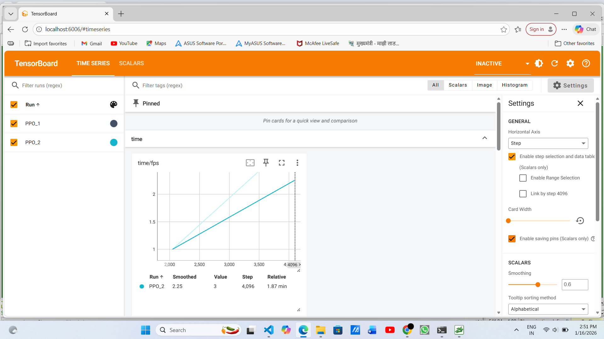
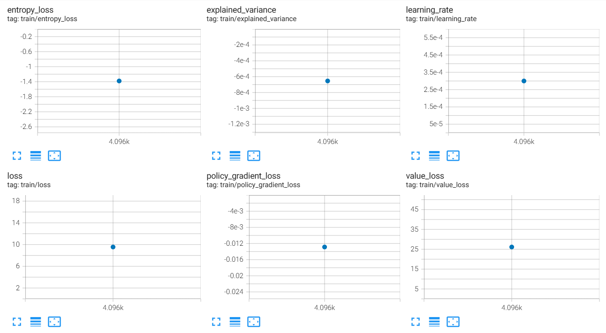
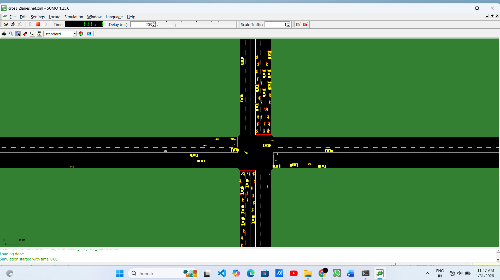

# Smart Route - Intelligent Traffic Management System
# 🚦 Smart Route: AI-Powered Traffic Signal Optimization

## 📌 Project Overview

This project presents an **intelligent and adaptive traffic signal control system** that integrates **computer vision**, **reinforcement learning**, and **traffic simulation** to overcome the limitations of conventional fixed-time traffic signals.

The system dynamically adjusts traffic signal phases based on **real-time traffic conditions**, aiming to reduce congestion, waiting time, fuel consumption, and emissions.

## ❓ Problem Statement

Traditional traffic signal systems operate using fixed signal timings and lack real-time adaptability. Such systems fail to respond effectively to fluctuating traffic demand, leading to congestion, increased waiting time, fuel wastage, and pollution—especially in heterogeneous traffic environments like India.

## 🎯 Objectives

* To design an adaptive traffic signal control system using Reinforcement Learning
* To simulate realistic traffic behavior using the SUMO simulator
* To use computer vision (YOLOv8) for traffic perception and vehicle counting
* To compare PPO with other RL algorithms such as DQN and A2C
* To evaluate system performance using training metrics and visual analytics

## 🏗️ System Architecture

The system is structured into **three major layers**:

### 1️⃣ Perception Layer

* Uses **YOLOv8** for vehicle detection and traffic density estimation
* Converts raw visual/simulation data into numerical traffic states

### 2️⃣ Decision Layer

* Uses **Reinforcement Learning** (PPO as primary algorithm)
* Observes traffic state and selects optimal signal phase actions
* Learns policies that minimize waiting time and congestion

### 3️⃣ Simulation & Control Layer

* **SUMO (Simulation of Urban Mobility)** simulates real-world traffic
* **TraCI** enables real-time control of traffic signals from Python
* Returns reward and next state to the learning agent

## 🧠 Reinforcement Learning Formulation

* **State (S):**
  Vehicle count per lane, queue length, waiting time, current signal phase

* **Action (A):**
  Selection of traffic signal phase (e.g., North-South green, East-West green)

* **Reward (R):**
  Negative waiting time and queue length to encourage smooth traffic flow

## ⚙️ Algorithms Used

* **PPO (Proximal Policy Optimization)** – Primary algorithm (stable & efficient)
* **DQN (Deep Q-Network)** – Baseline comparison
* **A2C (Advantage Actor-Critic)** – Performance comparison

## 🛠️ Tools & Technologies

* **Simulator:** SUMO
* **Interface:** TraCI
* **RL Framework:** Stable-Baselines3
* **Computer Vision:** YOLOv8
* **Programming Language:** Python
* **Visualization:** TensorBoard

## 📁 Project Structure
Traffic-Signal-Optimization-YOLO-RL/
│
├── sumo_env/        # SUMO network, routes, configuration files
├── yolo/            # YOLOv8 vehicle detection module
├── rl/              # Reinforcement learning logic
├── scripts/         # Helper and integration scripts
├── train_ppo.py     # PPO training script
├── requirements.txt # Project dependencies
├── README.md        # Project documentation
└── .gitignore       # Ignored files (logs, outputs)

## ▶️ How to Run the Project

### 1️⃣ Create and Activate Environment

conda create -n traffic_rl python=3.9
conda activate traffic_rl

### 2️⃣ Install Dependencies

pip install -r requirements.txt

### 3️⃣ Set SUMO Path (Windows)

set SUMO_HOME=C:\Program Files (x86)\Eclipse\Sumo

### 4️⃣ Train PPO Agent

python train_ppo.py

### 5️⃣ View Training Metrics

tensorboard --logdir runs

open you browser

## 📊 Results & Observations
## 📊 Results & Observations

### Training Performance

*PPO agent learning curve showing stable convergence over 4000+ timesteps*

### TensorBoard Metrics Dashboard

*Comprehensive training metrics: entropy loss, learning rate, policy gradient loss, value loss, and explained variance*

### SUMO Traffic Simulation

*Real-time traffic simulation showing adaptive signal control at 4-way intersection*

### Key Findings
* PPO learns adaptive signal control strategies effectively
* Reduced average waiting time compared to fixed-time control
* Stable learning behavior observed through TensorBoard metrics
* System adapts dynamically to changing traffic conditions
* Real-time decision making with 5-second action intervals
## 🚀 Future Scope

* Multi-intersection coordination using Multi-Agent PPO
* Integration with real-world CCTV feeds
* Emergency vehicle prioritization
* Accident and road-hazard awareness
* Deployment on edge devices (Jetson / Raspberry Pi)

## 📚 References

Key references include works by Li et al. (2016), Wei et al. (2018), Arel et al. (2010), and Van der Pol & Oliehoek (2016) on reinforcement learning-based traffic signal control.

## 👤 Author

**Rashmi Ravikumar**  
GitHub: [@RashmiRavikumar1985](https://github.com/RashmiRavikumar1985)

